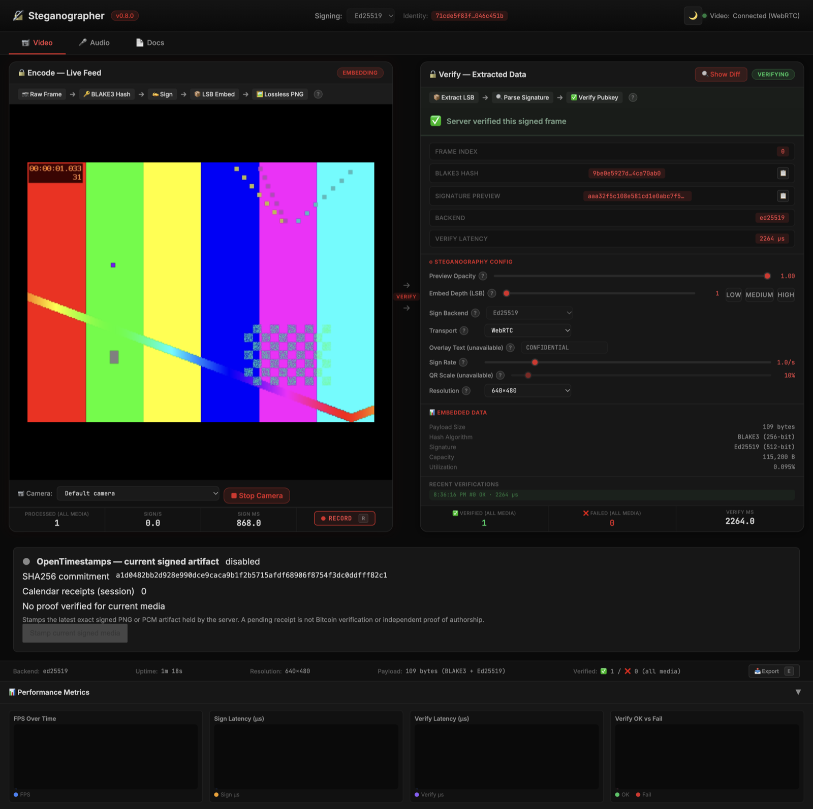
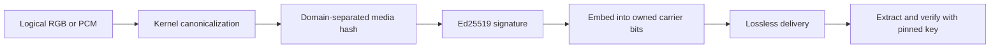

# Steganographer 0.8.1

Cryptographic media watermarking, bounded packet transport and forensic inspection in a five-crate Rust workspace.

**Revoked historical identity:** [Git history retains an exposed signing key](docs/security.md#historical-signing-key-exposure). Managed 0.8 signing and verification deny that identity; external applications must also retire its trust.



## Build and run

Rust **1.91+**. Native GStreamer integration needs GStreamer 1.22+ development libraries; optional codec evaluation also needs a C++ compiler. See [Getting Started](docs/getting-started.md) and [Platforms](docs/platforms.md).

```bash
git clone https://github.com/docxology/steganographer.git
cd steganographer
cargo build --workspace --all-features --locked
cargo run -p steganographer-cli -- dashboard --transport websocket --port 8080
```

Open `http://127.0.0.1:8080`. Camera/microphone access depends on browser permissions and a secure browser context. Remote binding requires authentication; keep public deployments behind suitable TLS and origin controls.

For the GStreamer-free CLI/dashboard:

```bash
cargo build -p steganographer-cli --no-default-features --locked
cargo run -p steganographer-cli --no-default-features -- dashboard --transport websocket
```

`./run.sh` provides an interactive menu. [`config/example.toml`](config/example.toml) and [`steganographer.toml`](steganographer.toml) select explicit synthetic input by default, never an implicit camera fallback. Their example embedding keys are public fixtures, not production secrets.

## Supported surfaces

| Surface | Contract |
| --- | --- |
| Offline CLI | Encode, decode, extract and verify signatures or generic packets; explicit keys/password files, atomic outputs, semantic exit codes and JSON envelopes |
| Dashboard | Ed25519 + BLAKE3 + LSB; signed PNG frames and exact PCM WAV chunks over WebSocket, optional WebRTC data-channel video |
| Native pipelines | Single-kernel LSB/DCT signed video, LSB signed audio, literal file/device/network input routing and explicit caller-owned pipelines |
| Native files | Exact RGB Matroska `.mkv`; whole-selection PCM `.wav` signed once at index 0, bounded to 64 MiB; atomic no-clobber publication after EOS |
| Forensics | Bounded byte, Unicode, ZIP/OOXML, PDF and statistical analysis, with explicit incomplete/budget results |
| OpenTimestamps | Standard SHA-256 detached proofs, fresh nonce-blinded calendar submissions, upgrades and Bitcoin verification through a configured trusted Esplora provider |
| WASM | Local packet/carrier/forensics facade; generated JavaScript bindings validate numbers before narrowing and report `u64` values as decimal strings |

### Signed media is not a lossy preview

Dashboard **Record** downloads a ZIP containing the actual signed PNG/WAV artifacts plus per-artifact verification metadata. These are sampled artifacts, **not continuous signed video/audio**. H.264 previews, browser camera previews and original microphone input are not substitutes for those bytes.

- Pin the signer's public key independently. An embedded key or a dashboard's self-reported identity is not organizational provenance.
- Encryption/ECC, Ethereum wallet signing and cryptographic QR overlays are not live dashboard capabilities; unavailable controls do not pretend otherwise.
- Preview opacity is display-only. Lossy codecs, resizing, resampling, OBS and conferencing clients can invalidate invisible marks.
- Native explicit sinks are caller-owned. A successful pre-sink signature check does not authenticate arbitrary downstream conversions.

## Cryptographic binding



Signature format **v4** is 109 bytes. The hash binds media kind, frame index, lengths and audio presence without ambiguous concatenation. Verification rejects weak Ed25519 keys and validates the delivered carrier's canonical content.

Generic **STG3 v1** packets have bounded locators/envelopes, validated flags/descriptors, content digests, keyed/interleaved placement and bounded transform reversal. Optional AEAD, Argon2id, Reed–Solomon and payload signatures have separate contracts; offline extraction without a trusted key is not authenticated verification.

Other core algorithms include DCT, keyed integer-QIM spread spectrum, adaptive placement, MDCT, hash chains and feature-gated Ethereum/FIPS 204 ML-DSA/hybrid APIs. Their names do not promise universal codec survival or calibrated forensic detection. RGB LSB shard spreading requires **all shards**; it is not erasure recovery.

See [Cryptography](docs/cryptography.md), [Algorithms](docs/algorithms.md), [Security](docs/security.md) and [Threat Model](docs/threat-model.md).

## CLI examples

```bash
# Generate a signing-key pair; paths/public key are printed, not private key bytes.
steganographer keygen --output mykey

# Generic bytes in a lossless image carrier.
steganographer encode --input cover.png --output packed.png \
  --payload-file report.pdf --mime-type application/pdf --bits 2
steganographer decode --input packed.png --output recovered.pdf --bits auto

# Argon2id-derived packet encryption; protect the password file separately.
steganographer encode --input cover.png --output encrypted.png \
  --payload-file report.pdf --password-file secret.txt --bits 2
steganographer decode --input encrypted.png --output recovered-secret.pdf \
  --password-file secret.txt --bits auto

# Structural/forensic inspection, not a proof that undetected data is absent.
steganographer scan --input exports --format json
steganographer --config config/example.toml config check --format json

# Finite native synthetic smoke; no camera or display opened.
steganographer --config config/example.toml video \
  --sink 'fakesink sync=false' --max-frames 3
```

Use [CLI Reference](docs/cli-reference.md) for trusted-signer verification, raw geometry, encryption key precedence, exit codes and generated completions/manuals. Existing outputs are not silently truncated; JSON never contains generated secrets.

### Native configuration boundaries

Configured source caps apply before signing. Framerate must negotiate with the source; the CLI does not manufacture/drop frames with an implicit rate converter. An explicit `--source` owns its caps and conversions.

Device input requires a recognized backend; `type = "test"` is explicit synthetic media. Managed file capture from a live/explicit source requires a positive frame/buffer limit. Unsupported live payload encryption/ECC/spreading, custom payload sizes and invisible-plus-visible signing chains fail before pipeline startup. See [Configuration](docs/configuration.md) and [GStreamer](docs/gstreamer.md).

## Workspace

| Crate | Responsibility |
| --- | --- |
| [steganographer-core](steganographer-core/) | Cryptography, packets, carriers, transforms, media algorithms and bounded forensic analysis |
| [steganographer-cli](steganographer-cli/) | Shared Clap command schema, offline/live commands, safe file I/O and generated shell/manual interfaces |
| [steganographer-dashboard](steganographer-dashboard/) | Authenticated HTTP/WebSocket/WebRTC service and signed-artifact browser UI |
| [steganographer-gst](steganographer-gst/) | AppSink/AppSrc bridges, exact native files and loadable `stegovideo`/`stegoaudio` elements |
| [steganographer-wasm](steganographer-wasm/) | Browser-local numeric-safe facade and versioned packet reports |

## Checks and evidence

```bash
cargo fmt --all -- --check
cargo test --workspace --locked
cargo test --workspace --all-features --locked
cargo clippy --workspace --all-features --all-targets --locked -- -D warnings
cargo +1.91.0 check --workspace --all-features --all-targets --locked
./scripts/status.sh --check
```

CI additionally configures dependency/security checks, immutable wire-vector gates, generated WASM binding checks and eight seeded sanitizer fuzz targets. Configuration of CI is not evidence that an unobserved hosted run passed. The [canonical test inventory](AGENTS.md#file-counts) is updated from executed results, not a static badge.

Release validation uses synthetic media and public test keys. Physical cameras/microphones, third-party virtual-camera consumers, Windows runtime deployment and independent Bitcoin full-node validation are separate boundaries—not implied by native builds or fake-device browser capture. Fresh pending calendar receipts are not newly Bitcoin-confirmed timestamps.

## Migration from 0.7

- Rust minimum: **1.91** for the updated RTC/codec stack.
- Legacy signature media must be **re-encoded as v4**; older signatures are rejected rather than reinterpreted.
- Older spread-spectrum carriers must be re-embedded with the new keyed integer modulation.
- Raw generic STG3 v1 frozen wire vectors remain unchanged; malformed/inconsistent packets now fail closed.
- WASM report schema: **`steganographer.packet-report.v2`**, exact decimal-string `u64` fields.
- Use explicit `type = "test"` for synthetic native input. Missing/unknown device backends no longer masquerade as capture.

See [Compatibility](docs/compatibility.md), [CHANGELOG](CHANGELOG.md), [API Reference](docs/api-reference.md), [OTS Integration](docs/ots-integration.md) and the [documentation index](docs/README.md). Planned work is tracked in [TODO.md](TODO.md) and [Roadmap](docs/roadmap.md), not advertised as implemented functionality.

## License

MIT — [LICENSE](LICENSE).
