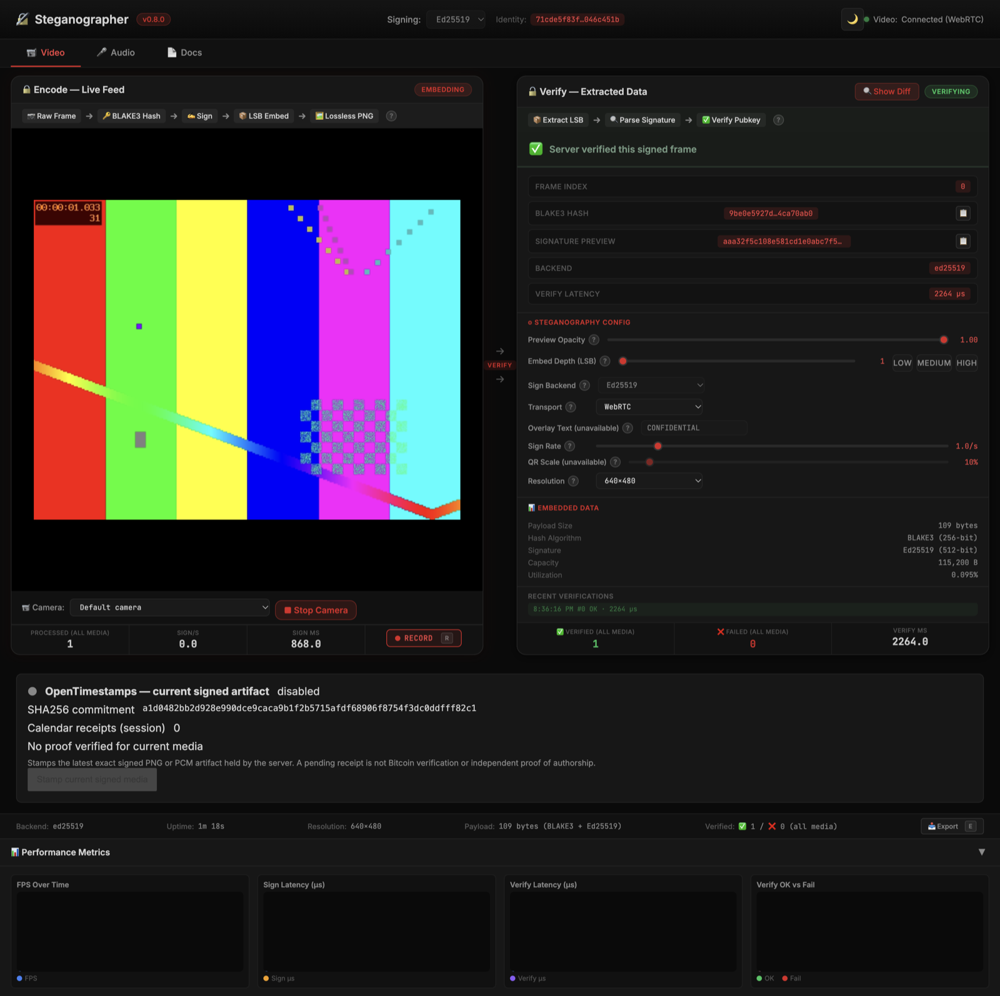
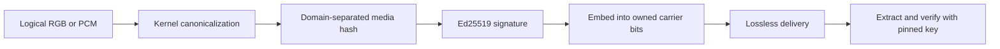

# Steganographer

<p align="center">
  <a href="https://github.com/docxology/steganographer/actions/workflows/ci.yml"></a>
  <a href="LICENSE"></a>
</p>

Steganographer is a Rust toolkit for signing and verifying media, embedding
and recovering data in lossless carriers, and inspecting files for hidden content.
It includes a command-line tool, a browser dashboard, and Rust and WASM libraries.

[Getting started](docs/getting-started.md) · [CLI reference](docs/cli-reference.md) · [Documentation](docs/README.md) · [Verification manuscript](docs/manuscript/README.md) · [Releases](https://github.com/docxology/steganographer/releases)

## Quickstart

With Rust **1.91+**, build the portable CLI and dashboard from a source checkout.

```bash
git clone https://github.com/docxology/steganographer.git
cd steganographer
cargo build -p steganographer-cli --no-default-features --locked
target/debug/steganographer dashboard --transport websocket --port 8080
```

Open <http://127.0.0.1:8080> and grant camera or microphone access to capture media.
Dashboard recordings contain sampled, lossless signed artifacts. For command-line
use, follow the [sign-and-verify walkthrough](docs/getting-started.md#2-sign-and-verify-a-raw-rgb-carrier)
or see [CLI examples](#cli-examples) below.



### Native GStreamer build

Install the GStreamer 1.22+ development libraries for native video and audio.
The optional codec evaluation also needs a C++ compiler. See
[platform requirements](docs/platforms.md) before building the full workspace.

```bash
cargo build --workspace --all-features --locked
```

With the native build, run bounded synthetic video without opening a camera or
display.

```bash
target/debug/steganographer --config config/example.toml video \
  --sink 'fakesink sync=false' --max-frames 3
```

The [example configuration](config/example.toml) and [repository configuration](steganographer.toml)
select synthetic input and contain public fixture embedding keys. See the [configuration
reference](docs/configuration.md) for file and device sources. The interactive
menu is available through `./run.sh`.

## Supported surfaces

| Surface | Contract |
| --- | --- |
| Offline CLI | Encode, decode, extract and verify signatures or generic packets; explicit keys/password files, atomic outputs, semantic exit codes and JSON envelopes |
| Dashboard | Ed25519 + BLAKE3 + LSB; delivered signed PNG/raw PCM over WebSocket, optional RTC JSON/base64 data-channel video; WAV wrappers for archive export |
| Native pipelines | Single-kernel LSB/DCT signed video, LSB signed audio, literal file/device/network input routing and explicit caller-owned pipelines |
| Native files | Exact RGB Matroska `.mkv`; whole-selection PCM `.wav` signed once at index 0, bounded to 64 MiB; atomic publication after EOS, with no-clobber by default |
| Forensics | Bounded byte, Unicode, ZIP/OOXML, PDF and statistical analysis, with explicit incomplete/budget results |
| OpenTimestamps | Standard SHA-256 detached proofs, fresh nonce-blinded calendar submissions, upgrades and Bitcoin verification through a configured trusted Esplora provider |
| WASM | Local packet/carrier/forensics facade; generated JavaScript bindings validate numbers before narrowing and report `u64` values as decimal strings |

### Record and independently verify signed media

Dashboard **Record** downloads a ZIP of signed PNG snapshots or PCM WAV chunks
with per-artifact metadata. The dashboard reports its own verification results.
For independent verification, extract the entries, use the manifest's parameters,
and verify against a public key obtained through a trusted channel. See
[recording and verification](docs/faq.md#can-i-record-and-save-the-signed-videoaudio)
and [key rotation and revocation](docs/key-rotation.md).

Keep the downloaded media lossless. Transcoding, resizing, and resampling can
invalidate the mark. H.264 previews and opacity controls affect the preview.
Native explicit sinks are caller-owned and may apply downstream conversions.

## Cryptographic binding



Signature format **v4** is 109 bytes. The hash binds media kind, frame index, lengths and audio presence without ambiguous concatenation. Verification rejects weak Ed25519 keys and validates the delivered carrier's canonical content.

Generic **STG3 v1** packets have bounded locators/envelopes, validated flags/descriptors, content digests, keyed/interleaved placement and bounded transform reversal. Optional AEAD, Argon2id, Reed–Solomon and payload signatures have separate contracts; offline extraction without a trusted key is not authenticated verification.

Other core algorithms include DCT, keyed integer-QIM spread spectrum, adaptive placement, MDCT, hash chains and feature-gated Ethereum/FIPS 204 ML-DSA/hybrid APIs. Their names do not promise universal codec survival or calibrated forensic detection. RGB LSB shard spreading requires **all shards**; it is not erasure recovery.

See [Cryptography](docs/cryptography.md), [Algorithms](docs/algorithms.md), [Security](docs/security.md) and [Threat Model](docs/threat-model.md).

## CLI examples

From the repository root, use the built binary with fresh output paths.
The packet examples use an existing lossless cover image and PDF.

```bash
target/debug/steganographer keygen --output mykey

target/debug/steganographer capacity --input cover.png --bits 2 \
  --filename report.pdf --mime-type application/pdf --format json
target/debug/steganographer encode --input cover.png --output packed.png \
  --payload-file report.pdf --mime-type application/pdf --bits 2
target/debug/steganographer decode --input packed.png --output recovered.pdf --bits auto

target/debug/steganographer scan --input packed.png --format json
target/debug/steganographer --config config/example.toml config check --format json
```

Keep the generated private key in protected storage. The
[password-protected packet walkthrough](docs/getting-started.md#4-password-protect-a-generic-packet)
shows how to encrypt a packet using a separate password file.

Use [CLI Reference](docs/cli-reference.md) for trusted-signer verification, raw geometry, encryption key precedence, exit codes and generated completions/manuals. Existing outputs are not silently truncated; JSON never contains generated secrets.

`capacity` accounts for actual locator/envelope/metadata and optional signing
overhead under effective limits; it is not a bound for encryption/ECC/compression
or keyed placement. Unavailable analysis is inconclusive (exit 5); detector and
traversal cutoffs are incomplete even if the CLI read all bytes. Positive scan
findings retain exit 4 precedence.

### Native configuration boundaries

Configured source caps apply before signing. Framerate must negotiate with the source; the CLI does not manufacture/drop frames with an implicit rate converter. An explicit `--source` owns its caps and conversions.

Device input requires a recognized backend; `type = "test"` is explicit synthetic media. Managed file capture from a live/explicit source requires a positive frame/buffer limit. Unsupported live payload encryption/ECC/spreading, custom payload sizes and invisible-plus-visible signing chains fail before pipeline startup. See [Configuration](docs/configuration.md) and [GStreamer](docs/gstreamer.md).

## Workspace

| Crate | Responsibility |
| --- | --- |
| [steganographer-core](steganographer-core/) | Cryptography, packets, carriers, transforms, media algorithms and bounded forensic analysis |
| [steganographer-cli](steganographer-cli/) | Shared Clap command schema, offline/live commands, safe file I/O and generated shell/manual interfaces |
| [steganographer-dashboard](steganographer-dashboard/) | Authenticated HTTP/WebSocket/WebRTC service and signed-artifact browser UI |
| [steganographer-gst](steganographer-gst/) | AppSink/AppSrc bridges, exact native files and loadable `stegovideo`/`stegoaudio` elements |
| [steganographer-wasm](steganographer-wasm/) | Browser-local numeric-safe facade and versioned packet reports |

## Checks and evidence

```bash
cargo fmt --all -- --check
cargo test --workspace --locked
cargo test --workspace --all-features --locked
cargo clippy --workspace --all-features --all-targets --locked -- -D warnings
cargo +1.91.0 check --workspace --all-features --all-targets --locked
./scripts/status.sh --check
```

CI additionally configures dependency/security checks, immutable wire-vector gates, generated WASM binding checks and eight seeded sanitizer fuzz targets. Configuration of CI is not evidence that an unobserved hosted run passed. The [canonical test inventory](AGENTS.md#file-counts) is updated from executed results, not a static badge.

Release validation uses synthetic media and public test keys. Physical cameras/microphones, third-party virtual-camera consumers, Windows runtime deployment and independent Bitcoin full-node validation are separate boundaries—not implied by native builds or fake-device browser capture. Fresh pending calendar receipts are not newly Bitcoin-confirmed timestamps.

## Release artifacts

The release workflow records the exact source and build variants in its
provenance. To build and check a release locally, run from a clean source
checkout on macOS or Linux with Rust, `tar`, `gitleaks`,
Node.js, Python 3.12+, the `wasm32-unknown-unknown` target and a `wasm-bindgen`
generator matching `Cargo.lock`. Native builds also need GStreamer 1.22+.

```bash
bash scripts/release.sh --output dist/reviewed-release --variant all
python3 scripts/check-release.py dist/reviewed-release
gzip -t dist/reviewed-release/*.tar.gz
```

The output path must not exist. `portable`, `native` and `wasm` select individual
variants; `all` includes them plus the exact source snapshot, inventory,
provenance and checksums. Default source capture reads the committed Git tree's
regular blobs/modes, not mutable worktree/index bytes. `--allow-dirty` captures
working-tree bytes explicitly marked dirty and **not commit-bound**, even if
the worktree was clean; it is not a point-in-time worktree snapshot.
No command publishes or modifies tags. Host binaries are not statically bundled
or cross-compiled. Strict single-member gzip rejects trailing padding or extra
members; the checker also rejects duplicate normalized archive paths before
inventory/extraction. See [Scripts](scripts/README.md) for the complete contract.


## Migration from 0.7

- Rust minimum: **1.91** for the updated RTC/codec stack.
- Legacy signature media must be **re-encoded as v4**; older signatures are rejected rather than reinterpreted.
- Older spread-spectrum carriers must be re-embedded with the new keyed integer modulation.
- Raw generic STG3 v1 frozen wire vectors remain unchanged; malformed/inconsistent packets now fail closed.
- WASM report schema: **`steganographer.packet-report.v2`**, exact decimal-string `u64` fields.
- Use explicit `type = "test"` for synthetic native input. Missing/unknown device backends no longer masquerade as capture.
- Native convenience file APIs now require trailing `overwrite: bool`; pass
  false for no-clobber or true for intended replacement, with no old-signature
  shim. Aliases reject; private output publishes only after EOS. Filesink still
  requires a trusted output directory.
- RTC requests are STGO-framed JSON/base64 (`jpeg_b64`), not raw binary JPEG.
  Whole chunks are ≤16 KiB; complete serialized requests must fit 4 MiB.
  Oversize errors advise smaller resolution or WebSocket selection.

See [Compatibility](docs/compatibility.md), [Release history](docs/releases/CHANGELOG.md), [API Reference](docs/api-reference.md), [OTS Integration](docs/ots-integration.md) and the [documentation index](docs/README.md). Planned work is tracked in [Project notes](docs/archive/project-notes.md) and [Roadmap](docs/roadmap.md), not advertised as implemented functionality.

## License

MIT — [LICENSE](LICENSE).
