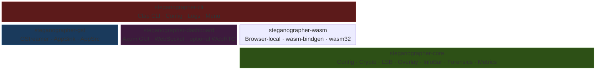

# Steganographer Documentation

Comprehensive documentation for the steganographer toolkit — a Rust workspace for real-time steganographic watermarking of video and audio streams with cryptographic authentication.

## Current Evidence Boundary

The dashboard returns lossless signed PNG snapshots and signed PCM WAV chunks in bounded recording archives. Its verification panel is **server-reported**; downloaded entries need independent verification with a trusted, separately pinned public key. These are sampled artifacts, not continuous capture.

Dashboard signed visual overlays/QR, MetaMask and Ethereum modes are unavailable. Preview opacity is display-only. Core library backend availability does not imply dashboard or legacy-media support.

## Table of Contents

### Theory & Foundations

| Document | Description |
| ---------- | ------------- |
| [Steganography Theory](steganography-theory.md) | Deep dive into information hiding: history, information-theoretic security, spatial/frequency domain techniques, steganalysis, and modern advances |
| [Cryptography](cryptography.md) | BLAKE3 hashing, Ed25519/Ethereum signing, payload format, Kerckhoffs' principle, and post-quantum considerations |
| [Algorithms](algorithms.md) | LSB, keyed residue/QIM SS, checked DCT reconstruction, learned-model limits, capacity and forensic availability |

### Core Concepts

| Document | Description |
| --- | --- |
| [Architecture](architecture.md) | Five-crate structure, actual delivered-media verification, runtime identity, native ownership, transport/auth and archive trust boundaries |
| [Security](security.md) | Security model, threat analysis, steganalysis resistance, dashboard security, and hardening guidelines |
| [Threat Model](threat-model.md) | Adversary model, 10 threat categories (T1–T10), security boundaries, use-case scenarios, and residual risk analysis |

### User Guides

| Document | Description |
| --- | --- |
| [Getting Started](getting-started.md) | Installation, first build, quick tutorial, dashboard quickstart, and pipeline customization |
| [CLI Reference](cli-reference.md) | Complete command-line interface documentation with all options and examples |
| [Configuration](configuration.md) | Full TOML config format with pipeline, stego, overlay, and live dashboard settings |

### Integration

| Document | Description |
| --- | --- |
| [GStreamer Integration](gstreamer.md) | Pipeline architecture, AppSink/AppSrc, config-driven pipeline construction |
| [Platform Guide](platforms.md) | Linux v4l2, macOS AVFoundation, virtual devices, audio routing, Docker |
| [OTS Integration](ots-integration.md) | Exact-file SHA-256 commitments, standard detached proofs, pending status and trusted-provider verification limits |

### Development

| Document | Description |
| --- | --- |
| [API Reference](api-reference.md) | Complete Rust API: types, traits, structs, methods, dashboard endpoints, and `LiveConfig` |
| [Contributing](contributing.md) | Development workflow, coding standards, testing, adding new algorithms |
| [Roadmap](roadmap.md) | Planned features, extension points, and future work |
| [Compatibility](compatibility.md) | Compatibility & deprecation policy: SemVer semantics, wire-format rules, golden-vector stability, MSRV, and platform matrix |
| [Steganography Platform Plan](plans/steganography-platform/README.md) | Composable v0.6.x–v1.0 program for generic packets, carriers, formats, forensics, documents, CLI/WASM, validation, and migration |
| [FAQ](faq.md) | 30+ Q&As on concepts, build, usage, crypto, dashboard, and configuration |
| [Key Rotation](key-rotation.md) | Historical compromise record, independent trust pinning and current revocation/exit policy |

## Quick Links

- **Run**: `./run.sh` (interactive menu, reads `steganographer.toml`)
- **Dashboard**: `./run.sh` → option `1` (launches web GUI at `http://localhost:8080`)
- **Build**: `cargo build --workspace`
- **Test**: `cargo test --workspace` (count: canonical Tests line in root `AGENTS.md`; verify with the command itself)
- **CLI**: `cargo run -p steganographer-cli -- --help`
- **Config**: [`steganographer.toml`](../steganographer.toml) (master config)
- **Example**: [`config/example.toml`](../config/example.toml)

## Architecture at a Glance

## Dashboard Features

| Feature | Description |
| --------- | ------------- |
| **Live Feed** | Browser capture sampled at the configured signing cadence with request backpressure |
| **Signed Media** | Actual post-embed PNG / PCM verified by the server using its real runtime Ed25519 identity |
| **Preview Opacity** | Display-only; never alters the signed carrier or exported bytes |
| **Verification Data** | Server-reported status matched by artifact index and cache revision |
| **Config Controls** | Supported LSB depth, sampling cadence and capture settings; unsupported crypto/kernel modes reject |
| **Audio Tab** | Microphone visualization, signed returned PCM and chunk-level server verification |
| **Docs Tab** | Sanitized Markdown rendering with safe text fallback if rendering dependencies fail |
| **Transport Policy** | Query > saved > server default; only auto mode falls back from WebRTC |
| **Record & Save** | Bounded ZIP of sampled signed PNGs or PCM WAV chunks plus extraction manifest, not continuous WebM/microphone capture |
| **Independent Verification** | Separate CLI verification of downloaded entries with trusted public key and manifest parameters, not performed by the GUI |

## Validation and Useful Sections

Final release test counts are maintained by the integration owner in root [`AGENTS.md`](../AGENTS.md); this index does not duplicate them.

- [Implemented SS mapping and compatibility](algorithms.md#spread-spectrum-steganography)
- [DCT reconstruction and codec limits](algorithms.md#reconstruction-and-codec-limits)
- [Learned evaluation scope](algorithms.md#evaluation-scope)
- [Statistical availability and bounded forensic completeness](algorithms.md#statistical-availability-and-forensic-completeness)
- [Dashboard signed-media data flow](architecture.md#dashboard-signed-media-pipeline)
- [UI/archive trust boundaries](architecture.md#ui-archives-and-independent-verification)
- [Authentication and transport policy](architecture.md#dashboard-authentication-and-transport-policy)
- [Recording and independently verifying downloads](faq.md#can-i-record-and-save-the-signed-videoaudio)
- [Theory versus implemented QIM](steganography-theory.md#spread-spectrum-theory-and-implemented-qim)
