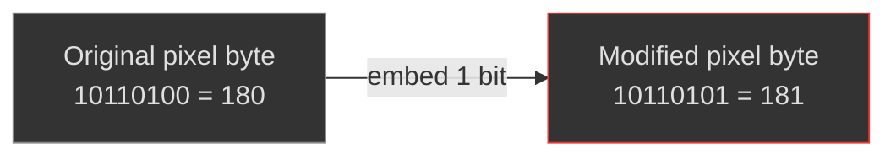
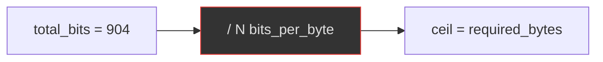
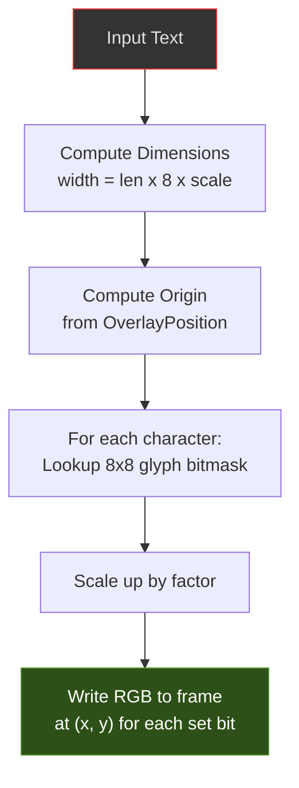

# Algorithms

## Overview

Steganographer exposes data-hiding kernels and separate visible rendering APIs. Availability in core does not imply availability in a signed native pipeline or the dashboard.

| Algorithm | Carrier | Extraction | Module |
| --- | --- | --- | --- |
| LSB Video | Pixel low bits | Legacy signatures / separate generic packet path | `lsb_video.rs`, `carrier.rs` |
| LSB Audio | PCM low bits | Keyed legacy signatures / separate generic packet path | `lsb_audio.rs`, `carrier.rs` |
| Spread Spectrum | Keyed integer residue/QIM | Majority-decoded legacy signature | `spread_spectrum.rs` |
| DCT Video | 8×8 transform coefficients | Legacy signature | `dct_video.rs` |
| Learned | Keyed DCT chips | Short payload and decoder score, not identity proof | `learned/mod.rs` (opt-in) |
| Text Overlay / Info Bar | Visible pixels | Rendering, not independent signature verification | `overlay.rs`, `info_bar.rs` |

The dashboard supports Ed25519/BLAKE3/LSB only. Its signed visual overlays, QR, MetaMask and Ethereum modes are unavailable. Signed native pipelines accept one compatible invisible kernel, not mixed rendering chains.

---

## LSB Video Steganography

### Principle

Least Significant Bit (LSB) replacement modifies the lowest-order bits of pixel values to encode data. Small changes may be hard to see, but perceptual invisibility is content/display dependent and is not statistical undetectability.



### Embedding Protocol

1. **Serialize** the `SignaturePayload` (109 bytes = 872 bits)
2. **Prepend** a 32-bit length prefix (big-endian, value = 872)
3. **Replace** the lowest `N` bits of each pixel byte sequentially


**Total: 904 bits to embed**

### Capacity Requirements

The frame must have enough pixel bytes to hold all embedded bits:



| LSB Bits (N) | Required Bytes | Min Frame Size (RGB8) |
| --- | --- | --- |
| 1 | 904 bytes | 302 pixels (18×18) |
| 2 | 452 bytes | 151 pixels (13×12) |
| 3 | 302 bytes | 101 pixels (11×10) |
| 4 | 226 bytes | 76 pixels (9×9) |

A typical 640×480 RGB frame has 921,600 bytes — far more than needed.

### Extraction Protocol

1. Read `N` LSBs from each pixel byte sequentially
2. Reconstruct the 32-bit length prefix
3. Validate the length matches `SignaturePayload::SERIALIZED_SIZE * 8` (872)
4. Reconstruct the 109-byte payload from the next 872 bits
5. Deserialize into a `SignaturePayload`

If the length prefix doesn't match 872, extraction returns `None` (no payload found). The payload is further validated by checking the 4-byte magic header (`STEG`) and 1-byte version number during deserialization.

### Visual Impact

The maximum change is `2^N - 1` integer levels per modified byte. One or two bits generally causes less distortion than higher bit depths; smooth areas, alpha and subsequent processing can make changes more apparent. There is no fixed SNR or universal perceptual guarantee.

### Supported Formats

| Format | Embedding Plane | Notes |
| --- | --- | --- |
| RGB8 | All 3 channels | Sequential across R, G, B |
| BGRA8 | All 4 channels | Includes alpha channel |
| YUV420 | Not yet supported | Future: embed in Y (luma) plane only |

---

## LSB Audio Steganography

### Principle

The legacy module modifies 16-bit PCM samples at keyed, frame-dependent permuted indices. The current mapping uses a Feistel permutation with cycle walking rather than allocating a Fisher–Yates shuffle. Extraction needs the same key, frame index, sample count and bit depth.

The format-4 mapping changed; older legacy artifacts must be re-encoded. Scattering positions does not encrypt payload bytes or defeat all statistical analysis.

### Embedding Protocol

Same length-prefix protocol as video, but bits are written to samples at permuted indices:

```text
For each permuted index i:
    sample[i] = (sample[i] & mask) | embedded_bits
```

The `mask` clears the lowest `N` bits: `mask = !((1 << N) - 1)`

### Capacity (16-bit PCM, Mono 44.1 kHz)

| Duration | Samples | Capacity (1-bit) | Capacity (2-bit) |
| --- | --- | --- | --- |
| 10 ms | 441 | 441 bits (55 bytes) | 882 bits |
| 100 ms | 4,410 | 4,410 bits (551 bytes) | 8,820 bits |
| 1 sec | 44,100 | 44,100 bits (5.4 KB) | 88,200 bits |

Including the 32-bit length prefix, a 109-byte signature needs 904 one-bit samples (about 20.5 ms at 44.1 kHz), not just the 872 payload bits.

### Audibility Impact

The maximum change is `2^N - 1` integer sample levels. This is small relative to full-scale PCM but audibility depends on signal level, silence, playback gain and content. No universal inaudibility or fixed SNR is established.

---

## Text Overlay

### Principle

Burns visible text directly into frame pixel data using a built-in 8×8 bitmap font. This is not steganography (the text is visible), but serves as a complementary visual watermark.

### Built-in Font

The overlay module includes a complete 8×8 pixel bitmap font covering:

- All uppercase and lowercase Latin letters (A-Z, mapped case-insensitively)
- Digits 0-9
- Common punctuation: `! # : - . / { } _`
- Unknown characters render as a filled rectangle

Each glyph is encoded as 8 bytes (one per row), where each bit represents a pixel.

### Rendering Pipeline



### Configuration

| Parameter | Default | Options |
| --- | --- | --- |
| `text` | `"STEGANOGRAPHER"` | Any ASCII string; supports `{timestamp}`, `{frame_index}`, `{date}`, `{time}` placeholders |
| `position` | `bottom-right` | `top-left`, `top-right`, `bottom-left`, `bottom-right`, `center` |
| `color` | `(255, 255, 255)` | Any RGB tuple |
| `scale` | 2 (16×16 px chars) | 1–8 |
| `font_size` | 16 | Maps to scale via `scale = font_size / 8` |

Template placeholders such as `{timestamp}` and `{frame_index}` expand during rendering. These visible strings are not independently authenticated provenance.

### Supported Formats

| Format | Color Mapping |
| --- | --- |
| RGB8 | Direct R, G, B write |
| BGRA8 | Swapped to B, G, R, A=255 |
| YUV420 | Not supported (no-op) |

---

## Info Bar Overlay (Exoteric Mark)

### Principle

The Info Bar is a separate visible rendering API for a high-contrast metadata bar. Printed hashes, barcodes or QR content do not themselves verify a signature or establish a trusted signer. It is not supported as part of the signed live invisible-kernel pipeline.

### Components

The Info Bar dynamically generates and renders four components per frame:

1. **Timestamp**: ISO 8601 UTC timestamp of the exact rendering moment
2. **Details String**: A summary of the applied steganography (e.g., `STEGO: LSB-1 | KEY: 8E78... | PAYLOAD: 109B`)
3. **1D Barcode (Code-128)**: A machine-readable encoding of the core signature or payload identifier
4. **2D QR Code**: A dense square code linking to the verification portal or containing the full public key/hash

### Rendering Pipeline

1. Clear the bottom 80 pixels of the frame to black
2. Render white text for the timestamp and details string
3. Generate the Code-128 barcode matrix from data
4. Generate the QR Code matrix from data
5. Scale and bitmap-blit the codes into the black region alongside the text

### Purpose

- Visible text/codes may help inspection, but optical readability depends on rendering and capture conditions.
- Verification still needs actual extracted data, a cryptographic check and a trusted public key.
- The dashboard does not implement signed QR/visual overlays. Preview opacity changes display only, never the downloaded signed carrier.

---

## Algorithm Comparison

| Property | LSB Video/Audio | Spread Spectrum | DCT Video | Learned | Visible rendering |
| --- | --- | --- | --- | --- | --- |
| Placement | Low bits | Keyed residue classes | Block coefficients | Keyed coefficient chips | Visible pixels |
| Decode | Exact low bits | Majority votes | Coefficient decision | Trained decoder | Optical inspection |
| Compression guarantee | None | None | None | None | No cryptographic guarantee |
| Signed payload | Legacy / separate generic path | Legacy | Legacy | Not an identity signature | Not standalone proof |

Lossless preservation is the supported evidence path. Noise and codec results require measurements on the actual carrier, settings and delivery path.

---

## Spread-Spectrum Steganography

### Principle

The implemented method is **keyed integer residue quantization (QIM) with repeated PN chips**, not additive direct-sequence spread spectrum. It avoids host-texture interference without averaging neighboring pixels or flattening PCM.

### Algorithm

For integer amplitude `a`, let `s = floor((a + 1) / 2)`. Each payload bit is XORed with a keyed PN chip and projected to the nearest valid integer lattice of that class, with period `2s`. The detector reads `floor(value / s) mod 2` (Euclidean division for signed PCM), removes the keyed chip and majority-votes over `spread_factor` units. Ties decode as zero.

Projection stays within amplitude of the original scalar, including unsigned-byte and signed-PCM extrema. Because the decision uses residue class rather than host magnitude, ordinary nonuniform/gradient texture does not overwhelm clean recovery. This is a clean-carrier recovery property, not a codec/noise or natural-image stealth guarantee.

### Parameters and Capacity

The default amplitude is 3 and spread factor is 64. Checked `try_new` constructors validate amplitude, minimum spread and arithmetic bounds; convenience `new` constructors panic on invalid parameters. Video amplitude is 1–255, PCM amplitude 1–32767, and spread must be at least 8. CLI policy may be narrower than the library.

For a 109-byte legacy payload, capacity requires `872 × spread_factor` eligible units (55,808 at the default):

| Interface | Eligible unit | Mapping |
| --- | --- | --- |
| `SpreadSpectrumVideo` media trait | One pixel | Green only in RGB/BGRA; excludes alpha and row padding |
| `SpreadSpectrumAudio` media trait | One PCM frame | First channel only; other channels unchanged |
| Video raw bit helpers / offline scalar path | One `u8` | Supplied scalar byte slice |
| Audio raw bit helpers / offline scalar path | One `i16` | Supplied scalar sample slice |

Raw `embed_bit` and `extract_bit` are fallible and retain `Result`; capacity/range failure is not a successful bit. Offline scalar placement and native trait placement must not be interchanged. Native trait SS signing currently rejects because its mapping differs from the offline canonical binding.

Earlier additive or host-averaging SS artifacts are incompatible: **re-embed from the original media**. Repeated chips may tolerate some changes, but no Gaussian-SNR, JPEG or geometric-attack guarantee is established.

---

## DCT-Domain Video Steganography

### Principle

Embeds payload bits into mid-frequency DCT coefficients of 8×8 pixel blocks. Working in the same transform family as JPEG does not guarantee survival of JPEG, H.264, colorspace conversion or other processing.

### Algorithm

1. **Divide** the frame into 8×8 pixel blocks
2. **Apply** a 2D DCT to each block (using f64 precision)
3. **Modify** a mid-frequency coefficient (selected by zigzag index):
   - Round the coefficient to the nearest `quant_step` boundary
   - If bit=1, move to the upper half of the quantization cell
   - If bit=0, move to the lower half
4. **Reconstruct and check** the actual rounded/clamped integer block, re-transform it, and verify the intended decision before committing writes
5. **Reject atomically** if reconstruction changes a decision (including unstable saturation); do not return success with a corrupt payload
6. **Extract**: apply DCT, read the coefficient, determine which half of the quantization cell it falls in

### Parameters

| Parameter | Default | Range | Effect |
| --- | --- | --- | --- |
| `coef_index` | 20 | 1–63 (zigzag) | Which DCT coefficient to modify (mid-frequencies recommended) |
| `quant_step` | 16 | Embedding requires ≥8 | Larger steps alter distortion/decision margin; successful reconstruction is still checked |
| `channel` | 1 (green) | 0, 1, 2 | Selected packed color channel; no universal perceptual ranking |

### Capacity

Each 8×8 block holds one payload bit. For a 109-byte payload (872 bits):
- Need 872 complete 8×8 blocks; a 240×240 image has 900 blocks
- A 640×480 frame has 80×60 = 4,800 blocks — far more than needed

### Reconstruction and Codec Limits

Even an uncompressed cover can fail the reconstruction check, notably saturated content. Errors must propagate to the caller. Any claim about JPEG or other codec survival needs an explicit encode/decode experiment; no universal quality-factor threshold is supported.

### Supported Formats

| Format | Supported | Notes |
| --- | --- | --- |
| RGB8 | ✅ | Channel 0=R, 1=G, 2=B |
| BGRA8 | ✅ | Channel 0=B, 1=G, 2=R |
| YUV420 | ❌ | Not supported (planar format) |

---

## Learned Watermarking (opt-in `learned` feature)

A DCT-domain chip embedder whose decoder is a small trained neural network instead of a hard threshold. The committed `weights.bin` is loaded and validated without retraining. It embeds a short `u64` payload, not a cryptographic signer identity.

### Architecture

1. **Carrier**: 8×8 block DCT of the green channel (same machinery as DCT-Domain Video Steganography above; no FFT/DCT dependencies).
2. **Schedule (fixed, keyed)**: `bits × redundancy` slots (64 × 32 = 2048 by default) are assigned to distinct blocks via a seeded Fisher–Yates shuffle; each slot spreads one bit over 6 mid-frequency coefficients (zigzag 8–40 pool) with ±`strength` chips. Coefficient choice and chip signs derive from BLAKE3 of `(seed, bit, copy)`.
3. **Decoder (trained)**: per bit, the 32 slots' chip responses are reduced to a 128-dimensional feature vector (per slot: raw response, response/RMS, mean |coefficient|, max |coefficient|), fed through a 128→32→1 tanh MLP; the bit is the sign of the output logit. A 9-candidate block-aligned shift search (multiples of 8 up to 16 px), scored by per-bit vote consistency, makes extraction robust to block-aligned content shifts (circular by scope).
4. **Baseline**: a plain majority vote over the slots' response signs is provided (`majority_extract`) for comparison.

### What is trained vs fixed

- **Trained** (in `weights.bin`): MLP parameters `W1[128×32]`, `b1[32]`, `W2[32]`, `b2[1]` — 4161 f32 values.
- **Fixed**: carrier, chip schedule, feature definition, alignment search, pooling.

### Weights format

`[magic 'LWM1' 4][version u8 = 1][payload len u64 LE][weights bytes (little-endian f32)][blake3(payload) 32]`. `built_in()` validates magic, version, length, and checksum.

### Training

`cargo run --release -p steganographer-core --features learned --example train_learned` trains on synthetic covers (gradients, curves and smoothed noise), not a licensed natural-image corpus. The training augmentations include Gaussian/salt-and-pepper noise, simulated coefficient quantization, blur and block-aligned circular shifts.

Simulated “CRF28” quantization is an RGB-domain training approximation, **not** a faithful libx264 roundtrip or an equivalence to a particular encoder setting. Block-aligned circular shifts do not establish arbitrary-crop robustness.

### Evaluation Scope

The shipped model's synthetic evaluation exercises the same family of covers/augmentations used by training. It does not establish natural-image performance, generalization or real-codec resilience. Recorded real H.264 experiments did not recover the watermark reliably; simulated quantization success cannot be substituted for that failure.

Timing, distortion and BER depend on carrier dimensions, configuration and environment. Use the opt-in evaluation tools for a reproducible workload rather than treating fixed numbers as a throughput or robustness guarantee.

### Honest limits

- Small model trained on synthetic covers only; same-distribution recovery is not natural-image calibration.
- Real-codec robustness is not established; measured H.264 failure is a known limitation.
- Crop/shift evaluation is block-aligned and circular, not arbitrary cropping, scaling or rotation.
- `built_in()`, `with_config()` and `with_model()` return `Result`; configuration requires 64 bits, nonzero redundancy and finite positive strength. Nondefault settings are not the shipped model's validated operating point.
- `embed(&mut VideoFrame, u64) -> Result<()>` validates format/layout/capacity. `extract(&VideoFrame) -> Option<(u64, f32)>` returns a decoder score, not a calibrated authenticity probability. RGB8/BGRA8 only.

---

## Future Algorithms

### Video Seal Integration (Planned)

Video Seal integration is not implemented. Published neural-watermarking results elsewhere do not establish robustness for Steganographer's current kernels.

---

## Steganalysis Resistance

### Implemented Kernels

Sequential LSB replacement is susceptible to chi-squared, RS and other steganalysis. Keyed placement changes positions but does not prove statistical indistinguishability. Low payload utilization can reduce exposure in some settings; it is not a calibrated detection-rate claim. QIM and DCT also introduce structure and must not be labeled inherently undetectable or indistinguishable from sensor noise.

### Statistical Availability and Forensic Completeness

The RS estimator has synthetic replacement controls; chi-squared and related outputs depend on sufficient usable input and model assumptions. Neither these controls nor the detector corpus establishes accuracy or probabilities on natural images. Unavailable/degenerate statistical results are **not clean results**.

Structural forensics is separate: bounded ZIP/OOXML analysis checks local/central structure, CRC/deflate and XML-related evidence; PDF analysis is bounded lexical inspection, not a full PDF interpreter; Unicode detection is heuristic and encoding-sensitive. Reports distinguish evidence, `detected`, completeness and resource/parse limitations. A latched positive remains positive when evidence is capped; an incomplete negative leaves uncertainty.

### Overlay Modules

Text and Info Bar are visible rendering, not concealment or standalone cryptographic proof. The dashboard disables signed visual-overlay/QR controls rather than pretending these are authenticated output modes.

---

## Further Reading

- [Steganography Theory](steganography-theory.md) — Information-theoretic foundations, steganalysis deep dive
- [Cryptography](cryptography.md) — BLAKE3 + Ed25519 details
- [Security](security.md) — Threat model and attack resistance
- [Threat Model](threat-model.md) — Adversary analysis, 8 threat categories, use-case scenarios
- [Configuration](configuration.md) — Configuring LSB bits, overlay, and pipeline parameters
- [Roadmap](roadmap.md) — Planned capabilities and extension boundaries
