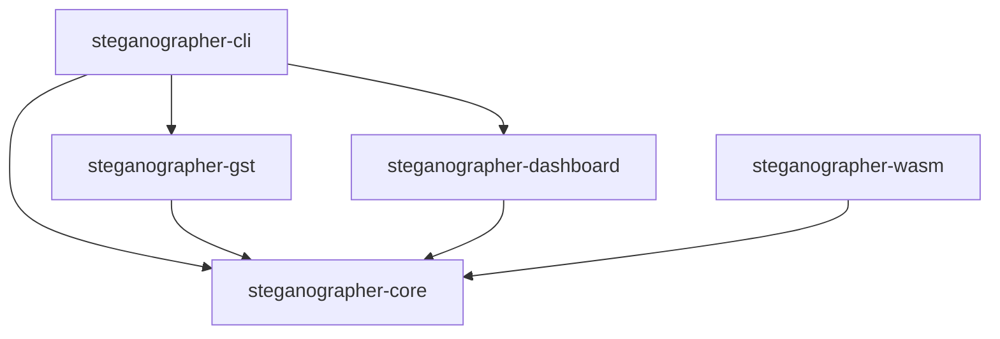
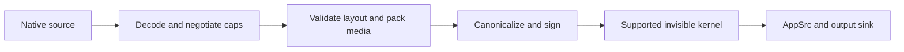

# Architecture

## Overview

Steganographer has five workspace crates. Media acquisition and delivery are separate from packet/carrier algorithms; network and filesystem features in core are optional, not a promise that every core feature is I/O-free.

## Design Principles

### Layering and module boundaries

| Crate | Responsibility |
| --- | --- |
| `steganographer-core` | Packet framing, bounded decode, carrier geometry, canonical carrier binding, crypto, stego kernels, statistical and structural analysis; optional learned/OTS/signing features |
| `steganographer-gst` | Native elements and AppSink/AppSrc bridges, packed pixel/sample conversion, caps/segments, bus errors and EOS delivery |
| `steganographer-dashboard` | Axum HTTP/WebSocket service, optional WebRTC transport, shared signed-media pipeline, bounded caches and browser UI |
| `steganographer-cli` | Validated configuration, media file I/O, key/output policy, command dispatch and machine-readable outcomes |
| `steganographer-wasm` | Browser-facing packet/carrier/forensic APIs with checked JS numeric boundaries and explicit decode limits |

`carrier_binding` lives in core and is shared by CLI and native signing. It defines which carrier regions a kernel owns. Hashing excludes those regions so extraction can verify delivered media without an unsigned private copy. This does **not** authenticate every container byte, ancillary metadata field, or arbitrary rendering transformation.

### Trait-based algorithms and generic packets

Legacy media modules implement `VideoStegoModule` or `AudioStegoModule`; both expose fallible embedding and `Result<Option<SignaturePayload>>` extraction. A trait implementation is not sufficient to establish a compatible signed-media pipeline: the signing canonicalization must match its exact placement.

The opt-in generic packet path separates `PacketCodec` framing from `CarrierEmbedder`/`CarrierExtractor` placement. Locator-first bounded decoding and explicit `DecodeLimits` apply before trusting declared sizes. Generic signatures authenticate logical payload bytes, not arbitrary semantic envelope metadata. A signed packet without a separately pinned signer establishes mathematical integrity, not authorship.

Legacy `SignaturePayload` format 4 retains its fixed 109-byte size, with unambiguous frame index, media lengths and audio-presence framing. Earlier legacy formats are rejected and must be re-encoded. Frozen STG3 protocol-v1 packets are a separate format.

### Configurable pipelines, not arbitrary signed chains

Plain rendering/kernel APIs may compose operations. Signed live pipelines accept exactly one supported invisible kernel. Mixing invisible embedding with a visible text/info-bar overlay, or selecting unsupported encryption/ECC/spreading in a live path, fails rather than silently ignoring settings.

Spread-spectrum uses keyed bounded integer residue/QIM and majority detection. Its video trait maps green pixels only; its audio trait maps the first PCM channel. Offline scalar helpers operate on byte/sample slices instead. Native trait-based SS signing is rejected because the offline canonical binding is not the same mapping. Earlier additive/averaged SS artifacts must be re-embedded.

DCT embedding checks extraction from reconstructed integer blocks before committing writes; unstable saturation is an error, not a successful watermark. Neither DCT nor SS implies universal codec robustness. Learned watermarking is an optional fallible library API for a short payload; its decoder score is not an identity proof.

## Data Flow

### Native embedding and delivery

Rows are packed for signing: row padding is not image content. Native exact file outputs are RGB Matroska (`.mkv`) and PCM WAV (`.wav`). File audio is gathered within its bounded whole-file budget and signed at index 0; explicit `max_buffers` limits the selection. Downstream errors and EOS drain/finalization are part of delivery, not just a successful appsrc push. Arbitrary downstream lossy codecs or screen capture may destroy embedded data.

### Dashboard signed-media pipeline

1. Accept bounded image/PCM input and snapshot the validated configuration for that operation.
2. Canonicalize carrier media and sign with the actual runtime Ed25519 signer using BLAKE3.
3. Embed LSB data and return **lossless PNG** or the actual signed **S16LE PCM** bytes.
4. Verify from the post-embed delivered artifact: PNG is decoded again; audio uses the delivered samples. Extraction and canonical hashing use that artifact's metadata, not the latest configuration or pre-embed snapshots.
5. Publish asynchronous verification results with the artifact index and server-wide monotonic cache revision. Connection-local sequence/index values alone are not unique across reconnects.

The public identity returned by the API is the public key of this same signer, stable for that server runtime. Restarting may generate a different key. It is not independently established person/organization identity. CLI/library consumers, including private caller applications, must independently pin a trusted public key rather than trust a key delivered alongside an artifact.

### UI, archives and independent verification

The browser displays **server-reported** verification and matches it to the current artifact's index/revision. It does not independently verify the exported archive. Camera/request and transport generations discard stale asynchronous work; the client allows one outstanding signing request. Server admission, verification queues, image/audio limits and WebRTC chunk/reply budgets bound work. Overload fails visibly rather than creating an unbounded queue.

Recordings are bounded stored-ZIP archives of sampled signed PNG snapshots or returned PCM WAV chunks plus an extraction manifest. The manifest records public key, indices, bit depth and, for audio, the public extraction key. These are not continuous VP9/WebM recordings or uninterrupted microphone capture; sampling, backpressure and capture gaps remain relevant. Reaching an archive cap stops recording visibly. Verify the downloaded PNG/WAV entries separately with a trusted public key and their manifest parameters; successful browser counters alone do not prove their contents.

Preview opacity affects display only, not the signed media. Signed visual overlays, QR provenance, MetaMask and Ethereum dashboard signing are unavailable, not alternate working modes. Core/library Ethereum, ML-DSA and hybrid signing support does not imply those backends work in the dashboard or fixed Ed25519 legacy media format.

## Threading & Memory Models

### macOS application ownership

Cocoa/AVFoundation application bootstrap belongs to the executable. The CLI dispatches native video/audio commands through `gstreamer::macos_main` before constructing Tokio. Reusable headless library operations do not enter a process-global Cocoa loop on a caller's worker/test thread. Applications embedding the library own any required native main-loop integration.

### AppSink/AppSrc lifecycle

Bridges decouple source and sink with bounded queues, preserve negotiated caps/segments, validate stride and sample layouts, observe both buses and drain EOS. A per-iteration autorelease-pool guard scopes Objective-C temporaries on macOS. No fixed hardware-pool exhaustion threshold is promised across devices.

Dashboard shutdown/reconnect clears pending requests, timers, sockets, RTC peers, chunk assemblies and capture tracks. WebRTC peers are also reaped after failure, disconnection or idle/never-connected deadlines; transport cleanup is required even when signaling fails.

## Dashboard Authentication and Transport Policy

- Default bind is loopback. A network bind without an auth token is not a secure deployment; use a trusted reverse proxy/TLS where needed.
- Configured bearer auth guards mutations and `/api/webrtc/config` (which may disclose ICE configuration). Public read routes are not blanket-authenticated.
- Tokenless browser mutations reject a foreign Origin. WebSocket upgrades enforce their Origin gate and, when configured, a token via the supported query/subprotocol mechanism. CORS is not an authentication boundary; absent-Origin nonbrowser requests are not proof of local identity.
- HTTP config uses the existing **snake_case** schema. UI hydration precedes serialized full-object updates. Unsupported signer/hash/kernel/encryption/ECC settings reject.
- Video transport preference is URL query, then saved choice, then server default. Only `auto` may fall back from WebRTC to WebSocket; pinned WebRTC fails visibly. A transient fallback is not saved as the user's preference. Audio uses WebSocket.
- The Docs tab inserts rendered Markdown only after sanitization; absent/failed renderer or sanitizer falls back to text. Documentation content is not trusted executable HTML.

## Analysis and Trust Boundaries

RS/chi-squared outputs are statistical diagnostics, not calibrated natural-image probabilities. Unavailable statistics must remain unavailable rather than look like a clean result. ZIP/OOXML, PDF and Unicode analysis report findings, `detected`, completeness and bounded-resource reasons separately. A positive finding remains positive if display evidence is capped; an incomplete negative is not a clean bill of health.

OpenTimestamps commits the exact file SHA-256, unlike kernel-canonical media signatures. Pending calendar proofs are not Bitcoin-confirmed. Verification relies on an explicitly trusted Esplora provider, not independent full-node validation; see the dedicated integration guide.

## Error Handling

Capacity, layout, reconstruction, configuration, authentication and downstream delivery errors propagate through fallible APIs. CLI absence (exit 2), failed verification/revocation (exit 3), findings and partial scans are distinct outcomes; extraction without a public key is explicitly not verified. Invalid explicit configuration or malformed revocation state must not silently fall back to defaults.

## Architectural Decision: C2PA Interoperability

**Status: not implemented.** Steganographer does not emit or consume C2PA manifests. Its custom signed-carrier format must not be represented as C2PA-compliant provenance. A future interoperability design would need its own signed scope, trust and delivery requirements rather than relying on a visual QR mark.

## Further Reading

- [Algorithms](algorithms.md) — Placement, capacity and reconstruction limits
- [Configuration](configuration.md) — TOML and dashboard configuration
- [GStreamer Integration](gstreamer.md) — Native ownership and delivery
- [API Reference](api-reference.md) — Public interfaces and routes
- [FAQ: dashboard](faq.md#dashboard) — Recordings and trust expectations
- [Security](security.md) — Threat and deployment boundaries
- [OTS Integration](ots-integration.md) — Exact-artifact timestamp proofs
