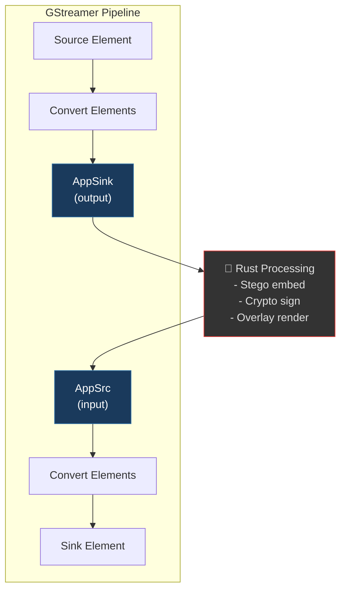

# GStreamer Integration

## Overview

The `steganographer-gst` crate provides the bridge between GStreamer's media handling and the core steganography algorithms. It uses the **AppSink/AppSrc** pattern for practical integration without requiring native GStreamer plugin compilation.

---

## Architecture

### AppSink/AppSrc Pattern



**Why AppSink/AppSrc?**

- No need to install compiled `.so`/`.dylib` plugin files
- Easier debugging — all processing happens in standard Rust code
- Full control over buffer lifecycle
- Simpler CI/CD — no `GST_PLUGIN_PATH` configuration needed

---

## Threading and macOS Integration

`steganographer_gst::init()` initializes GStreamer only: it does not load
`NSApplication` or start a Cocoa loop. Headless file/test pipelines execute
on the calling thread, including repeated calls and calls from worker threads.

On macOS, camera and GUI elements require application-owned Cocoa event
handling. The CLI dispatches live `video`/`audio` commands through
`gstreamer::macos_main` **once at process entry, before creating Tokio**.
Neither individual filters nor file helpers wrap themselves in a Cocoa loop.
Embedding applications must arrange the same entry-point ownership when using
camera/window elements; a library call must not take over an existing event loop.

---

## Video Filter Pipeline

### Configuration

```rust
pub struct VideoFilterConfig {
    pub source_pipeline: String,  // e.g., "videotestsrc ! videoconvert ! video/x-raw,format=RGB"
    pub sink_pipeline: String,    // e.g., "videoconvert ! autovideosink"
    pub signing_kernel: Option<SigningKernel>, // required with Some(signer)
}
```

### Processing Flow

1. Pull samples while checking both buses; source EOS drains queued input.
2. Parse each sample's caps and checked packed RGB/BGRA layout, gathering
   pixel bytes without row padding or metadata offsets.
3. If signing, canonicalize the kernel-owned regions and sign the logical pixels.
4. Embed, then extract from the actual modified pixels and verify their binding.
5. Scatter pixels back without modifying padding; preserve buffer timing.
6. Push samples with their current caps and TIME segment, including renegotiation.
7. Send output EOS and wait for downstream drain. Source/sink errors and stalled
   operations return errors; guards return both pipelines to `Null` on failure.

Bridge waits are bounded (15 seconds per stalled operation). The post-embed
check happens **before AppSrc**; it does not authenticate arbitrary downstream
codecs, color conversion, container metadata, or a display's rendering.

```rust
pub fn run_video_filter(
    config: &VideoFilterConfig,
    stego: Box<dyn VideoStegoModule>,
    signer: Option<&Signer>,
    max_frames: Option<u64>,
) -> anyhow::Result<()>
```

`SigningKernel` is `Lsb { bits: u8 }`, `Dct`, or `SpreadSpectrum`.
The binding must describe the actual module; signing without a binding fails.
Video LSB and DCT bindings are supported. Trait-based spread-spectrum signing
is currently rejected: its green-channel mapping differs from the offline CLI
scalar binding. Audio signing supports LSB only.

The CLI signed live path accepts exactly one invisible kernel and Ed25519.
Unsupported live encryption/ECC/spreading and invisible-plus-visible
overlay/InfoBar compositions fail before pipeline startup. Plain rendering
and unsigned kernel APIs remain separate.

### Frame Format Mapping

| GStreamer Format | Core Format | Bytes/Pixel |
| ------------------- | --------------- | ----------- |
| `video/x-raw,format=RGB` | `VideoFormat::Rgb8` | 3 |
| `video/x-raw,format=BGRA` | `VideoFormat::Bgra8` | 4 |

---

## Audio Filter Pipeline

### Configuration

```rust
pub struct AudioFilterConfig {
    pub source_pipeline: String,  // e.g., "audiotestsrc ! audioconvert ! audio/x-raw,format=S16LE"
    pub sink_pipeline: String,    // e.g., "audioconvert ! autoaudiosink"
    pub signing_kernel: Option<SigningKernel>, // Some(Lsb { bits }) when signing
}
```

### Processing Flow

`run_audio_filter(config: &AudioFilterConfig, stego: &mut dyn AudioStegoModule,
signer: Option<&Signer>, max_buffers: Option<u64>) -> anyhow::Result<()>`
processes each selected input buffer independently. It validates complete
interleaved S16LE sample frames, signs the canonical PCM before embedding,
extracts and verifies the modified PCM, and preserves timing/caps/segments
through the bridge. Extraction later needs the original buffer boundaries and
indices; arbitrary re-chunking is not equivalent to this live path.

### Sample Format

Supports **interleaved S16LE** with validated positive rate/channel count and
complete sample frames, not just mono. Other formats/layouts fail.

### Exact file helpers

Both helpers live in `steganographer_gst::video_filter`:

```rust
pub fn process_video_file(
    input_path: &str,
    output_path: &str,
    stego: Box<dyn VideoStegoModule>,
    signer: Option<&Signer>,
    signing_kernel: Option<SigningKernel>,
    max_frames: Option<u64>,
) -> anyhow::Result<()>;

pub fn process_audio_file(
    input_path: &str,
    output_path: &str,
    stego: &mut dyn AudioStegoModule,
    signer: Option<&Signer>,
    signing_kernel: Option<SigningKernel>,
    max_buffers: Option<u64>,
) -> anyhow::Result<()>;
```

Video decodes to RGB and writes **raw RGB Matroska (`.mkv`)**. Audio decodes to
interleaved S16LE and writes **PCM WAV (`.wav`)**, with no conversion after
embedding. Other output extensions reject. Paths are quoted literal properties,
not launch-language fragments. Lossy downstream codecs may destroy watermarks;
no arbitrary lossy-output authentication is promised.

The audio file helper gathers all selected decoded PCM, bounded to **64 MiB**,
and embeds once at logical index **0**. Without `max_buffers` this means the
complete file; the limit, empty input, or midstream caps changes are errors,
not successful truncation. An explicit `max_buffers` selects a prefix.
Extract from the whole delivered WAV PCM at index 0, not decoder-sized chunks.
EOS drain finalizes the output container before success.

Release validation delivered and independently checked 17 RGB Matroska frames
(including padded RGB) and 14,336 WAV samples, plus downstream-error propagation.
These are headless synthetic-source/file runs, not evidence of physical-camera
or Windows execution.

---

## GStreamer Pipeline Strings

### Video Sources

| Element | Platform | Description |
| ----------- | -------- | ----------- |
| `videotestsrc` | All | Test pattern generator |
| `v4l2src device=/dev/video0` | Linux | V4L2 camera capture |
| `avfvideosrc` | macOS | AVFoundation camera |
| `ksvideosrc` | Windows | Kernel Streaming |

### Video Sinks

| Element | Platform | Description |
| ----------- | -------- | ----------- |
| `autovideosink` | All | Auto-select best display sink |
| `osxvideosink` | macOS | Native macOS window for low-latency preview |
| `v4l2sink device=/dev/video42` | Linux | V4L2 loopback output (Virtual Camera) |
| `filesink location=out.raw` | All | Write to file |

### Audio Sources

| Element | Platform | Description |
| ----------- | -------- | ----------- |
| `audiotestsrc wave=sine freq=440` | All | Test tone generator |
| `pulsesrc` | Linux | PulseAudio capture |
| `pipewiresrc` | Linux | PipeWire capture |
| `osxaudiosrc` | macOS | macOS audio capture |

### Audio Sinks

| Element | Platform | Description |
| ----------- | -------- | ----------- |
| `autoaudiosink` | All | Auto-select best audio output |
| `pulsesink` | Linux | PulseAudio output |
| `pipewiresink` | Linux | PipeWire output |

---

## Pipeline Construction

The CLI constructs full pipelines by combining user/config source and sink strings with the AppSink/AppSrc bridge:

```text
Source String:  "v4l2src device=/dev/video0 ! videoconvert ! video/x-raw,format=RGB"
                                                                          │
                                                                    AppSink ──── Rust Processing ──── AppSrc
                                                                                                         │
Sink String:    "videoconvert ! v4l2sink device=/dev/video42"     ◀───────────────────────────────────────┘
```

---

## Native Plugin (landed)

The crate builds as a loadable GStreamer plugin: `Cargo.toml` sets
`crate-type = ["cdylib", "rlib"]` (cdylib for `GST_PLUGIN_PATH` loading,
rlib so the CLI and tests keep linking it), and `lib.rs` declares the plugin
via `gstreamer::plugin_define!` under the name `steganographer_gst` — which
MUST match the cdylib file stem (`libsteganographer_gst.dylib`), because
GStreamer's loader derives the entry-point symbol
`gst_plugin_<file-stem>_get_desc` from the file name.

```bash
cargo build -p steganographer-gst --lib
GST_PLUGIN_PATH=target/debug gst-inspect-1.0 stegovideo   # lists properties
GST_PLUGIN_PATH=target/debug gst-inspect-1.0 stegoaudio  # lists properties

# Audio round-trip smoke (embed into a live tone, then decode the sink output):
GST_PLUGIN_PATH=target/debug gst-launch-1.0 \
  audiotestsrc num-buffers=16 samplesperbuffer=1024 \
  ! capsfilter caps=audio/x-raw,format=S16LE,layout=interleaved,rate=44100,channels=1 \
  ! stegoaudio packet-hex=<hex> bits-per-unit=2 \
  ! filesink location=out.pcm
steganographer decode --input out.pcm --output payload.bin \
  --stego-type lsb_audio --bits 2 --input-format raw_s16le --force
```

### `stegovideo` element (in-place `BaseTransform`)

Embeds a pre-encoded generic packet into every frame's least-significant
bits without changing buffer sizes or caps. Registered via
`register_elements()` for both cdylib plugin loading and direct application
registration.

Both native elements require `bits-per-unit` and keyed/sequential placement to
match the pre-encoded packet descriptors. Malformed packets and mismatched
configuration post a pipeline error, never clean EOS with silently unembedded
output. Insufficient buffer capacity remains a warned skip, allowing a later
sufficiently large buffer to deliver the packet; verify the delivered carrier.

**Pad templates are restricted** to packed one-plane `video/x-raw` formats —
`RGB`, `BGR`, `RGBx`, `BGRx`, `XRGB`, `XBGR` — so caps negotiation fails
loudly for anything the byte-sequential kernel cannot address, instead of
silently passing buffers through unembedded. (A runtime allowlist in
`transform_ip` remains as a backstop; the legacy AppSink/AppSrc filters
negotiate their own caps and are unaffected.)

**Embedding is stride-safe**: the wire format is the CLI packet path over the
*pixel-only* byte stream (`width × height × bpp` units); padded row-padding
bytes never carry packet bits. With no padding (`stride == row_bytes`) the
frame is processed in place; with padding the pixel stream is gathered and
scattered through a stride-aware slot mapping. Padding is preserved on every
frame, including later keyed frames; keyed frame 0 uses the configured key and
later frames use frame-index-derived keys.

**Property changes apply at frame granularity** (snapshot under a `StreamState`
mutex in the element's `imp` module): the next frame after a `key-hex` or
`bits-per-unit` change sees the new parameters, and both changes **reset the
frame counter** — the CLI expects `key-hex` to be set before the pipeline
reaches `PLAYING` so frame 0 embeds with the raw key.

Properties:

| Property | Type | Meaning |
| --- | --- | --- |
| `packet-hex` | string | Hex-encoded generic packet bytes |
| `bits-per-unit` | uint (1-4, default 1) | LSB bits used per carrier byte |
| `clear-payload` | bool (default false) | After the first embedded frame, zero the packet slots instead of re-embedding (sequential mode only) |
| `key-hex` | string | 32-byte hex embedding key; when set, packet bits are placed by the core `KeyedSpatialLsb` keyed permutation (key-driven slot selection instead of sequential leading slots) |

Wire format notes:

- Sequential mode (no `key-hex`) routes through `carrier::SpatialLsb`; output
  decodes with the same `decode` CLI command and `bits-per-unit` value used
  at embed time, and a whole multi-frame file decodes because the packet sits
  in the leading slots of the first frame.
- Keyed mode (non-empty `key-hex`) routes through `carrier::KeyedSpatialLsb`.
  The packet must have been encoded with `--embedding-key` so its envelope
  declares `PLACEMENT_KEYED`; extraction requires the same key. Placement is
  frame-scoped: frame 0 uses the raw key (first-frame output decodes via
  `decode --embedding-key` unchanged), and frame N mixes its index into the
  derivation (`kdf::derive_frame_embedding_key`), so equal buffers embed at
  different slots per frame while every frame decodes through the same
  derivation with its index. The keyed carrier's recognition tag binds the
  unit count, so keyed output decodes per frame, not from a multi-frame
  concatenation. `clear-payload` is ignored with a one-time warning in keyed
  mode.
- Packed single-plane RGB/BGR/RGBx/BGRx/XRGB/XBGR formats are embedded;
  negotiation rejects everything else (see the restricted pad templates above).

### `stegoaudio` element (in-place `BaseTransform`)

Audio sibling over interleaved little-endian S16 PCM: sequential
`carrier::AudioSpatialLsb` by default, keyed `KeyedAudioSpatialLsb` when
`key-hex` is set. Same property set as `stegovideo`; wire format verifies
with `decode --stego-type lsb_audio` (plus `--embedding-key` for keyed
carriers) and `--input-format raw_s16le` for headerless sink output. Each
buffer embeds the full packet independently, so a single-buffer capture
decodes on its own.

Its **pad templates are likewise restricted** to
`audio/x-raw, format=S16LE, layout=interleaved` (any rate/channels), so
negotiation fails loudly for anything else (the `set_caps` gate stays as a
backstop). Property changes apply at buffer granularity and
`key-hex`/`bits-per-unit` changes reset the buffer counter.

Example application-side registration:

```rust
use steganographer_gst::plugin::register_elements;
steganographer_gst::init()?;
register_elements()?;
let element = gstreamer::ElementFactory::make("stegovideo")
    .property("packet-hex", packet_hex)
    .property("bits-per-unit", 1u32)
    .build()?;
```

---

## Troubleshooting

### `gstreamer-1.0.pc` not found

GStreamer development files are not installed or `PKG_CONFIG_PATH` is not set.

```bash
# macOS (Homebrew)
brew install gstreamer

# Linux
sudo apt install libgstreamer1.0-dev libgstreamer-plugins-base1.0-dev
```

### `no element "avfvideosrc"`

The GStreamer installation doesn't include the AVFoundation plugin.

```bash
# macOS - ensure plugins-bad is included
brew install gstreamer  # Homebrew bundles all plugins
```

### Pipeline hangs or no output

1. Set `GST_DEBUG=3` to see GStreamer internal messages
2. Verify source/sink formats match with `gst-inspect-1.0 <element>`
3. Add `videoconvert` (video) or `audioconvert` (audio) between elements

---

## Config-Driven Pipeline Construction

Since v0.1.0, `run.sh` reads pipeline parameters from `steganographer.toml`:

```toml
[video.pipeline]
width = 1280
height = 720
framerate = 30
opacity = 1.0
```

These values are injected into GStreamer caps strings:

```bash
# Generated automatically by run.sh from config:
caps="video/x-raw,format=RGB,width=1280,height=720,framerate=30/1"
```

The Rust `VideoPipelineConfig` struct provides matching default values through `_or_default()` methods.

The Rust CLI also negotiates these caps for configured test/device/file/network
sources before signing, without inserting frame-rate resampling. Explicit
`--source` fragments own their caps and any intentional `videorate` conversion.
`type = "test"` is the explicit synthetic mode. Device input requires a
recognized backend; missing/unknown backends are errors, never fake capture.

Configured `.mkv` video and `.wav` audio outputs use private same-directory
temporary files and publish without clobber only after successful EOS/drain.
Live or explicit source fragments require a positive `--max-frames` /
`--max-buffers` when capturing to those managed files. Audio signs the whole
selected PCM once at index 0 (64 MiB bound). Arbitrary explicit sink fragments
remain caller-owned and can destroy signature evidence.

---

## Further Reading

- [Configuration](configuration.md) — Full TOML schema with `[video.pipeline]`
- [Architecture](architecture.md) — Crate structure and data flow
- [Platform Guide](platforms.md) — OS-specific GStreamer setup
- [Algorithms](algorithms.md) — What happens inside the processing loop
- [Steganography Theory](steganography-theory.md) — Theoretical foundations
