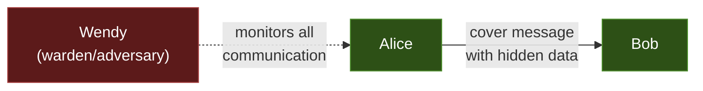
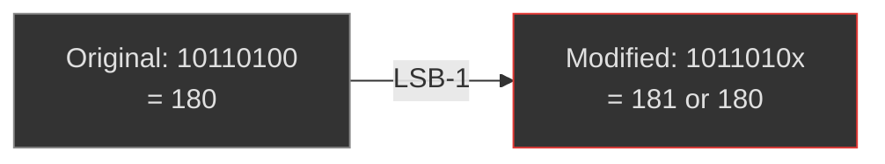
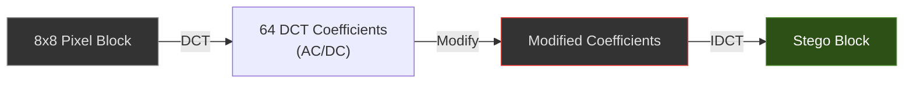
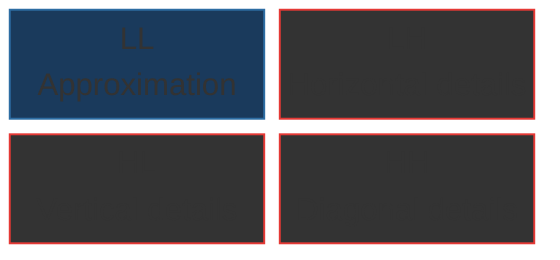

# Steganography Theory

A comprehensive guide to the science of information hiding — the theoretical foundations, mathematical models, practical techniques, and security analysis underpinning the Steganographer toolkit.

This chapter describes both general research ideas and implemented features. Theoretical robustness/security is not evidence that a shipped kernel has those properties. See [Algorithms](algorithms.md) for actual mappings, fallible interfaces and measured limitations; no natural-image detection calibration or universal codec guarantee is claimed.

---

## Table of Contents

1. [Historical Context](#historical-context)
2. [Information-Theoretic Foundations](#information-theoretic-foundations)
3. [Spatial-Domain Techniques](#spatial-domain-techniques)
4. [Frequency-Domain Techniques](#frequency-domain-techniques)
5. [Audio Steganography](#audio-steganography)
6. [Video Steganography](#video-steganography)
7. [Steganalysis — Detecting Hidden Data](#steganalysis)
8. [Steganography Meets Cryptography](#steganography-meets-cryptography)
9. [Modern Advances](#modern-advances)
10. [Further Reading](#further-reading)

---

## Historical Context

### Ancient Origins

Steganography (from Greek *στεγανός* "covered" + *γράφειν* "writing") predates cryptography as a discipline of secret communication:

| Era | Technique | Description |
| --- | --- | --- |
| ~440 BC | Histiaeus' slave | Shaved the slave's head, tattooed a message on his scalp, waited for hair to regrow, and sent him to Aristagoras |
| ~480 BC | Demaratus' wax tablets | Scraped wax off wooden tablets, carved message into wood, re-covered with wax |
| 1st century | Pliny's invisible ink | Used milk or plant juices that become visible when heated |
| Renaissance | Trithemius' *Steganographia* (1499) | Systematic treatise disguised as a book on angel magic |
| WWII | Microdots | Photographs shrunk to the size of a period, pasted into letters |
| Modern | Digital steganography | Embedding data in digital media (images, audio, video, network packets) |

### The Prisoners' Problem (Simmons, 1983)

Gustavus Simmons formalized the steganographic scenario: two prisoners, Alice and Bob, wish to communicate covertly while being monitored by a warden, Wendy. They can exchange seemingly innocent cover messages (e.g., images) but must hide their true communication within them. This model remains the foundation of modern steganographic security analysis.



---

## Information-Theoretic Foundations

### Cover Object and Stego Object

| Term | Symbol | Definition |
| --- | --- | --- |
| Cover object | *C* | The innocent carrier medium (e.g., unmodified video frame) |
| Stego object | *S* | The carrier after embedding the hidden message |
| Message | *M* | The secret data to embed (e.g., `SignaturePayload`) |
| Key | *K* | Optional shared secret controlling embedding (e.g., PRNG seed) |
| Embedding function | *Emb(C, M, K) → S* | Produces the stego object |
| Extraction function | *Ext(S, K) → M* | Recovers the hidden message |

### Cachin's ε-Security (2004)

Christian Cachin formalized steganographic security using the Kullback-Leibler (KL) divergence between the probability distributions of cover and stego objects:

```text
D_KL(P_C || P_S) ≤ ε
```

- **ε = 0**: *Perfectly secure* steganography — the stego object is statistically indistinguishable from the cover. This is the gold standard but is hard to achieve in practice.
- **ε > 0**: *ε-secure* steganography — the distributions differ by at most ε. Smaller ε means harder to detect.
- **ε → ∞**: Trivially detectable.

### Shannon's Information-Theoretic Model

Claude Shannon's foundational work on information theory underpins steganographic capacity:

- **Embedding rate** (*R*): hidden bits per total cover sample; LSB-1 provides up to one bit per selected scalar, while sparse use has a lower overall rate.
- **Distortion** (*D*): a chosen difference metric between cover and stego objects. With independent balanced bits, LSB-1 replacement changes about half the selected samples; this is not a universal perceptual distortion value.
- **Capacity–Distortion Tradeoff**: increasing rate often increases distortion or detectability, but the relationship depends on cover distribution, placement and the detector.


There is no universal embedding-rate threshold below which a watermark is undetectable. Capacity, distortion and detectability must be measured separately under a specified cover/channel model.

### Kerckhoffs' Principle Applied to Steganography

Just as Kerckhoffs' principle states that a cipher should be secure even if everything except the key is public, **steganographic security must not rely on secrecy of the embedding algorithm**. An adversary should be assumed to know:

- The embedding method (LSB replacement, DCT, etc.)
- The cover source distribution
- Any fixed framing or protocol structure; the detection question is whether a message is present

A secret key may protect extraction/placement or encryption; it alone does not make modified media statistically indistinguishable. Detection resistance needs its own cover-distribution evidence.

---

## Spatial-Domain Techniques

Spatial-domain methods directly modify pixel/sample values.

### LSB Replacement (Used by Steganographer)

The simplest and most widely deployed technique. Replace the least significant bit(s) of each sample with message bits:



**Advantages**: Simple, fast, high capacity
**Disadvantages**: Vulnerable to chi-squared and RS steganalysis

#### LSB Matching (±1 Embedding)

Instead of *replacing* LSBs, randomly *add or subtract* 1 from samples whose LSB does not match. This avoids the same simple pair-equalization mechanism, but does not preserve every natural statistic:

```text
If sample LSB ≠ message bit:
    sample += random_choice(-1, +1)
```

LSB matching requires different steganalysis; being harder for one detector is not a general security proof. This section is background, not a claim that Steganographer's LSB replacement kernel implements matching.

### Pixel-Value Differencing (PVD)

Proposed by Wu & Tsai (2003). Embeds data in the *difference* between adjacent pixel pairs. Larger differences (edge regions) can embed more bits because the human visual system is less sensitive to changes in high-contrast areas:

| Pixel Difference | Bits Embedded | Rationale |
| --- | --- | --- |
| 0–15 (smooth) | 2 bits | Low tolerance for change |
| 16–31 | 3 bits | Moderate tolerance |
| 32–63 | 4 bits | High tolerance |
| 64–127 | 5 bits | Edge region, high tolerance |
| 128–255 | 6 bits | Strong edge, maximum capacity |

### Matrix Encoding

Uses error-correcting codes to embed *n* bits by modifying only *1* cover sample in every *2^n - 1* samples. Dramatically reduces embedding distortion:

| Technique | Bits per change | Efficiency |
| --- | --- | --- |
| LSB-1 | 1 bit / 1 change | 1.0 |
| Hamming(3,1) | 1 bit / ~0.5 changes | 2.0 |
| Hamming(7,1) | 1 bit / ~0.25 changes | 4.0 |
| Syndrome coding | Approaching theoretical limit | ~*n* |

---

## Frequency-Domain Techniques

Frequency-domain methods transform the signal first, then embed in coefficients. They can be designed for particular compression/noise channels, but transformation alone does not confer robustness.

### Discrete Cosine Transform (DCT)

Used by JPEG compression. Embeds data in the quantized DCT coefficients of 8×8 image blocks:



**Key properties**:

- JPEG re-compression may preserve or destroy data depending on coefficient selection, quantization, colorspace conversion and the particular embedding scheme
- Mid-frequency coefficients are preferred (balancing perceptibility and robustness)
- JSteg, F5, and OutGuess are well-known DCT steganographic algorithms

### Discrete Wavelet Transform (DWT)

Decomposes the image into multi-resolution sub-bands (LL, LH, HL, HH). Embedding in the detail sub-bands (LH, HL, HH) provides good robustness:



**Advantage**: Better energy compaction than DCT; multi-scale embedding allows adaptive capacity.

### Spread Spectrum: Theory and Implemented QIM

Classical direct-sequence spread spectrum (DSSS) modulates a message with a pseudo-noise (PN) sequence and adds it to the host at low power:

```text
stego_signal = cover + α · PN_sequence · message_bit
```

Correlation recovery depends on host interference, clipping, synchronization and attack assumptions. Robust DSSS designs may tolerate certain noise/compression channels; they do not automatically survive arbitrary geometric attacks.

Steganographer's current `SpreadSpectrumVideo`/`SpreadSpectrumAudio` instead use keyed **bounded integer residue/QIM** projection. A payload bit XORed with PN chips selects integer lattice classes; extraction reads those classes and majority-votes. Ordinary textured covers therefore do not overwhelm clean detection, and projection bounds per-unit changes without averaging host pairs. This is not the additive formula above and does not establish equivalent channel robustness.

The video trait uses green pixels (not alpha/padding), and the audio trait uses the first PCM channel. Offline raw helpers use scalar `u8`/`i16` slices and return `Result`; the mappings must not be interchanged for signing. Older additive/averaged SS artifacts require re-embedding. See [implemented SS details](algorithms.md#spread-spectrum-steganography).

---

## Audio Steganography

Audio steganography exploits properties of human auditory perception (psychoacoustics).

### Techniques

| Method | Principle | Typical tradeoff, not a guarantee |
| --- | --- | --- |
| **LSB (implemented)** | Modify PCM low bits | High capacity; fragile to sample changes |
| **Phase coding** | Modify FFT-bin phase | Synchronization/processing sensitive |
| **Echo hiding** | Add controlled short echoes | Content and channel dependent |
| **Classical spread spectrum** | PN modulation across a band | Redundancy trades capacity for a specified noise margin |
| **Patchwork** | Opposite changes to sample groups | Low capacity; depends on statistical assumptions |
| **Wavelet-based** | Embed in DWT coefficients | Depends on sub-band and attack model |

Only the implemented kernels listed in [Algorithms](algorithms.md) are available; this table is not a feature inventory.

### Psychoacoustic Masking

Human hearing has frequency-dependent masking thresholds. A strong sound can mask weaker nearby components, but inaudibility requires a content/playback model; the current simple PCM kernels are not a calibrated psychoacoustic encoder.

### Keyed Permutation (as used in Steganographer)

The legacy LSB audio module uses a keyed, frame-dependent Feistel permutation with cycle walking, without allocating a full shuffle. The format-4 mapping must match at extraction. Key, frame index, carrier length and bit depth matter; merely knowing the signing public key does not locate keyed audio samples.

Scattered positions may frustrate a sequential detector but do not encrypt the payload, make its existence undetectable, or establish resistance to all statistical attacks.

---

## Video Steganography

Video steganography extends image techniques with temporal considerations.

### Temporal Approaches

| Category | Technique | Description |
| --- | --- | --- |
| **Intra-frame** | Per-frame LSB/DCT/DWT | Each frame treated independently (Steganographer's approach) |
| **Inter-frame** | Temporal difference embedding | Embed in the differences between consecutive frames |
| **Motion vector** | Modify H.264/HEVC motion vectors | Robust to spatial processing but fragile to re-encoding |
| **Scene change** | Embed at scene boundaries | Low capacity but high imperceptibility |
| **Compressed domain** | Modify VLC/CAVLC coefficients directly | No decode/re-encode needed |

### Frame Selection Strategies

Not all frames are equally suitable for embedding:

- **I-frames** (keyframes): Full spatial data, best for spatial-domain methods
- **P-frames** (predicted): Contain motion vectors and residuals
- **B-frames** (bidirectional): Most complex, least stable for embedding

Live video operates on decoded raw frames rather than modifying compressed-domain I/P/B syntax. Signing cadence and capture/backpressure can select only some frames; dashboard recordings are sampled artifacts, not proof of continuous capture.

### Capacity vs. Robustness per Frame

The legacy 109-byte LSB payload plus length prefix needs 904 carrier bytes at one bit per byte (302 RGB pixels), not 904 pixels. A 640×480 RGB frame contains 921,600 bytes. Low utilization is not itself a quantified security result, particularly when placement is sequential.

---

## Steganalysis

Steganalysis is the science of detecting hidden data. It is the adversary to steganography.

### Passive vs. Active Wardens

| Warden Type | Capability | Countermeasure |
| --- | --- | --- |
| **Passive** | Only observes; detects presence of hidden data | Statistical indistinguishability |
| **Active** | Modifies the medium (e.g., re-compression) to destroy hidden data | Channel-specific robust design plus measured delivery tests; no blanket guarantee |
| **Malicious** | Replaces or forges content | Cryptographic authentication (Steganographer's approach) |

### Detection Techniques for LSB Replacement

#### Chi-Squared Attack (Westfeld & Pfitzmann, 1999)

LSB replacement with sufficiently balanced payload bits can equalize frequencies in pairs of values (POVs), such as 180 and 181. Natural cover distributions and embedding rates determine how useful this signal is:

```text
Natural image:  P(180) ≠ P(181)  (random natural distribution)
After LSB stego: P(180) ≈ P(181)  (forced equalization)
```

The chi-squared statistic measures this equalization. Steganographer's **video** module is vulnerable to this attack because it uses sequential LSB replacement.

#### RS Analysis (Fridrich et al., 2001)

Classifies pixel groups as Regular (R), Singular (S), or Unusable (U) based on a smoothness criterion. In natural images:

```text
|R_+1| > |S_+1|  and  |R_-1| > |S_-1|
```

Under the estimator's cover assumptions, changes in regular/singular counts can estimate random LSB replacement rate. Degenerate inputs, too few groups or model violations can make an estimate unavailable or unreliable.

#### Sample Pair Analysis (SPA) (Dumitrescu et al., 2003)

Studies sample-pair relationships under an LSB replacement model. Its assumptions and false-positive/negative behavior still need evaluation on the intended covers.

#### Deep Learning Steganalysis

Learned detectors depend on training distribution, embedding method/rate and cover-source mismatch. Published performance on another corpus cannot be transferred to Steganographer's carriers. Low payload rate alone does not establish that a neural detector will fail.

### Evidence and Availability in Steganographer

| Component | Supported interpretation | Not established |
| --- | --- | --- |
| LSB video/audio | Replacement/placement mechanism and recovery checks | Calibrated natural-cover detectability |
| RS estimator | Synthetic random-replacement controls and explicit unavailable outcomes | Probability that a natural image contains steganography |
| Chi-squared and other statistics | Diagnostics subject to input/estimator assumptions | A clean result when the statistic is unavailable |
| DCT / keyed QIM | Defined carrier decisions and clean recovery limits | Inherent stealth or universal codec robustness |
| Text / Info Bar | Visible rendering | Cryptographic verification from appearance alone |

Structural forensics is not equivalent to statistical steganalysis. ZIP/OOXML inspection is bounded across local/central records, CRC/deflate and XML evidence; PDF inspection is lexical rather than full rendering/interpreting; Unicode indicators can have benign explanations. Findings, `detected`, completeness and budget/parse limitations are separate outputs. A capped evidence list cannot erase a positive detection, and incomplete negative analysis must retain uncertainty.

---

## Steganography Meets Cryptography

### The Composition Principle

Steganography and cryptography are complementary but distinct:

| Property | Cryptography | Steganography |
| --- | --- | --- |
| **Goal** | Make data unreadable | Make data invisible |
| **Failure mode** | Data readable but known to exist | Data detectable but may remain unreadable |
| **Key role** | Decrypt/verify | Locate/extract |
| **Without key** | Ciphertext visible, content hidden | Placement may be unknown; detection/removal may still be possible |

Encryption and signing are different. A signature is not ciphertext and does not hide its payload. Generic packets support an explicit encrypt-before-embed transform; legacy encrypted payloads use a versioned wrapper carrying a fresh packet ID. Raw AEAD callers must ensure packet-ID uniqueness per key. Mathematical signature validity establishes neither a real-world author nor trust in a key supplied by the artifact itself.

Legacy media signatures cover canonical media excluding kernel-owned regions, not every container bit or displayed metadata field. Generic signatures cover logical payload bytes, not arbitrary semantic envelope metadata. A caller must independently pin a trusted signer.

### Provable Security for Steganography

Formal steganographic constructions such as Hopper, Langford and von Ahn's work rely on explicit channel-sampling and computational assumptions. These results are not a proof for arbitrary LSB, QIM or DCT implementations.

Natural cover distributions are difficult to model. Steganographer does not claim perfect cover sampling, a measured KL-divergence bound or provable natural-image indistinguishability.

### Deniable Steganography

Some steganographic schemes support **plausible deniability**: the sender can reveal a decoy message if coerced, while the true message remains hidden. This requires multiple layers of embedding with independent keys.

### Post-Quantum Considerations

| Threat | Impact on Steganography | Impact on Cryptography |
| --- | --- | --- |
| Grover's algorithm | Halves the effective security of symmetric keys (e.g., 256-bit → 128-bit effective) | Moderate |
| Shor's algorithm | Breaks nothing directly in steganography | Breaks RSA, ECDSA, Ed25519 |

Ed25519 is not post-quantum. Optional library ML-DSA/hybrid backends are separate from the dashboard and fixed Ed25519 media payload. Quantum-resistant signing would not, by itself, prove hidden-data undetectability or codec robustness.

---

## Modern Advances

### Generative Adversarial Network (GAN) Steganography

GANs can generate cover images that are *optimized* for embedding, or can directly produce stego images from scratch:

- **SteganoGAN** (Zhang et al., 2019): Encoder/decoder network pair trained end-to-end
- **HiDDeN** (Zhu et al., 2018): Differentiable noise layers simulate attacks during training
- **ISSBA** (Li et al., 2021): Invisible sample-specific backdoor attacks as steganographic channels

### Adversarial Embedding

Uses adversarial machine learning to embed data in regions that specifically fool steganalysis networks. The embedding function is trained against a discriminator (steganalysis CNN):

```text
min_Embed  max_Analyzer  L(Analyzer(Embed(cover, message)), "cover")
```

### Neural Network Watermarking (Video Seal)

Video Seal and related research evaluate learned encoder–decoder watermarks under specified transformations. Their reported compression/crop/scale results are not universal guarantees and do not transfer to Steganographer. Video Seal integration is not implemented.

Steganographer's optional learned DCT-chip model was trained on synthetic covers. Its simulated quantization tests are not real H.264 validation; recorded real-codec experiments did not establish successful recovery. Its extracted short payload and decoder score are not cryptographic identity proof.

### Timestamp Commitments and Provenance

A timestamp proof can establish a commitment's inclusion no later than a supported chain event under a verifier's trust assumptions. It does not establish authorship, capture time, truth of the content or uninterrupted recording. A signature additionally needs an independently pinned signer, and a hash-chain segment needs a trusted predecessor and external segment order.

Steganographer's OTS path commits exact file SHA-256 and verifies supported Bitcoin proofs using a trusted Esplora provider, not an independent full node. Pending calendar attestations are **not verified**. See [OTS Integration](ots-integration.md) for operational limits.

---

## Further Reading

### Foundational Papers

| Paper | Authors | Year | Contribution |
| --- | --- | --- | --- |
| *The Prisoners' Problem* | G. Simmons | 1983 | Formal steganographic model |
| *An Information-Theoretic Model for Steganography* | C. Cachin | 2004 | ε-security framework |
| *Attacks on Steganographic Systems* | A. Westfeld, A. Pfitzmann | 1999 | Chi-squared steganalysis |
| *Reliable Detection of LSB Steganography* | J. Fridrich et al. | 2001 | RS analysis |
| *Detection of LSB Steganography via Sample Pair Analysis* | S. Dumitrescu et al. | 2003 | SPA method |
| *Provably Secure Steganography* | N. Hopper et al. | 2002 | Theoretical foundation |
| *Defining Security in Steganographic Systems* | C. Cachin | 1998 | KL divergence model |

### Textbooks

- **Katzenbeisser & Petitcolas**, *Information Hiding: Techniques for Steganography and Digital Watermarking* (2000)
- **Fridrich**, *Steganography in Digital Media: Principles, Algorithms, and Applications* (2009)
- **Cox, Miller, Bloom**, *Digital Watermarking and Steganography* (2nd ed., 2007)

### Standards

| Standard | Scope |
| --- | --- |
| ISO/IEC 19794-5 | Biometric data interchange (watermarking context) |
| FIPS 204 (ML-DSA) | Post-quantum digital signatures |
| RFC 8032 | Ed25519 specification (used by Steganographer) |
| NIST SP 800-188 | De-identification of personal information (related) |

### Related Steganographer Documentation

- [Algorithms](algorithms.md) — Implementation-specific algorithm details
- [Cryptography](cryptography.md) — BLAKE3 + Ed25519 deep dive
- [Security](security.md) — Threat model and attack analysis
- [Architecture](architecture.md) — System design and module interactions
